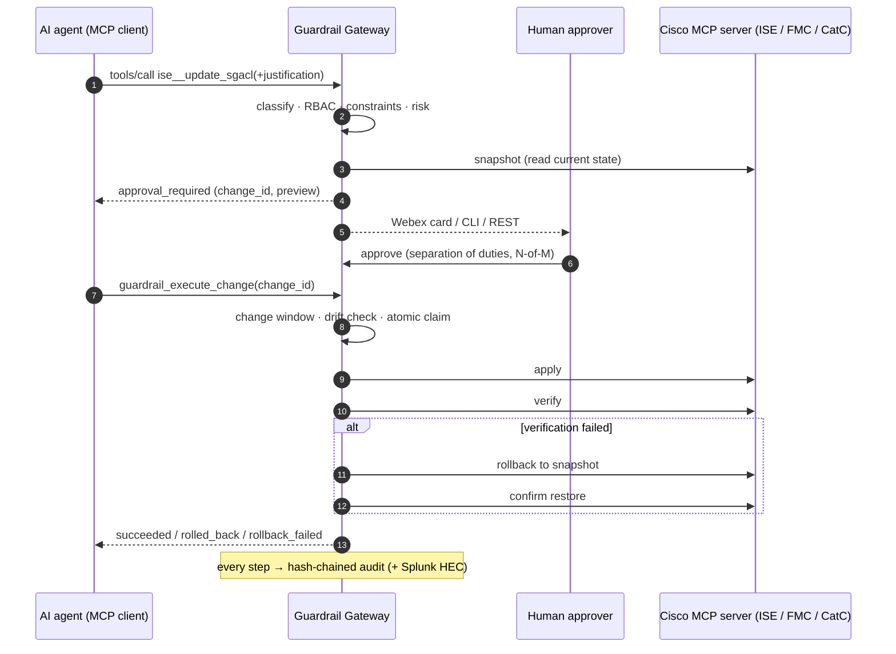
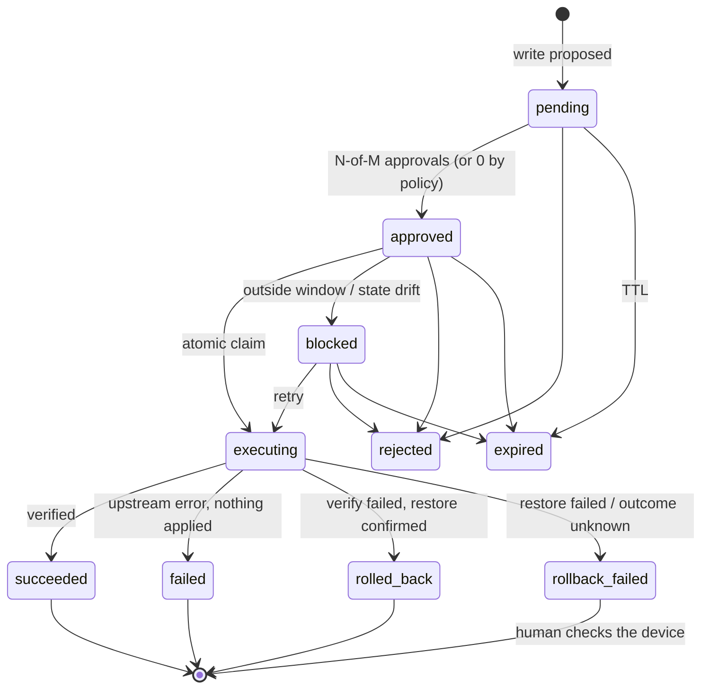
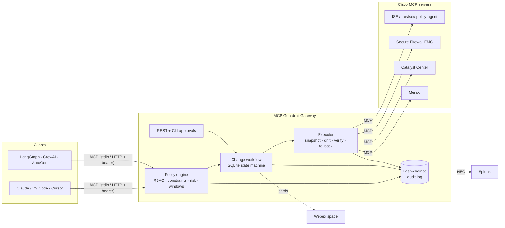

# MCP Guardrail Gateway

**Human-approved, verified, auto-rollback write actions for AI agents on Cisco MCP servers.**

[](https://github.com/natrajexplore/mcp_guardrails/actions/workflows/ci.yml)


Most Cisco MCP servers on Code Exchange are deliberately *read-only by construction*, because nobody wants an LLM
pushing an SGACL or a firewall policy on its own. The result is that agents can explain the network but can't fix it.

**MCP Guardrail Gateway is the missing safety layer.** It sits between any MCP client (Claude, VS Code Copilot, Cursor,
LangGraph, CrewAI, ...) and one or more Cisco MCP servers (ISE, Secure Firewall/FMC, Catalyst Center, Meraki, or the
companion [trustsec-policy-agent](https://github.com/natrajexplore/trustsec-policy-agent)). Reads pass straight
through. Every write becomes a **change request** that gets the same discipline a change advisory board (CAB) applies
to a human engineer: least privilege, review, approval, a maintenance window, pre- and post-checks, rollback, and an
audit trail.

> **The agent proposes. A human approves. The gateway executes, verifies, and rolls back if reality doesn't match.**

## Contents

- [How it works](#how-it-works)
- [Use Case](#use-case)
- [Security by design](#security-by-design)
- [Features](#features)
- [Architecture](#architecture)
- [Related Sandbox](#related-sandbox)
- [Installation](#installation)
- [Quick start (5 minutes, no lab required)](#quick-start-5-minutes-no-lab-required)
- [What the agent sees](#what-the-agent-sees)
- [Configuration](#configuration)
- [Usage reference](#usage-reference)
- [How to test the software](#how-to-test-the-software)
- [Known issues and limitations](#known-issues-and-limitations)
- [FAQ](#faq)
- [Developing with Claude Code](#developing-with-claude-code)
- [Getting help](#getting-help) · [Getting involved](#getting-involved) · [Credits](#credits) · [Licensing info](#licensing-info)

## How it works

| Step | What the gateway does |
|---|---|
| **Classify** | Each upstream tool is classified `read` / `write` / `destructive` from policy rules, MCP annotations and verb heuristics. **Unknown means write** (fail-safe). |
| **Authorize** | RBAC per identity: tool globs, allowed classes, maximum risk. Deny wins across roles. Tools a caller can't use are hidden from `tools/list` and answer like tools that don't exist. |
| **Constrain** | Argument guardrails (regex, allowed values, length) can deny a change (e.g. no `permit ip`) or escalate its risk. |
| **Preview** | The rule's *snapshot* call captures the current device state, so approvers see *before* next to *proposed*. |
| **Approve** | Humans approve over the CLI or REST. Separation of duties (no self-approval, agents can't hold approver roles), N-of-M approvers by risk, and TTL expiry. |
| **Execute** | Change windows are enforced. **State drift** since review blocks execution (TOCTOU protection). The change is claimed atomically, so it can't run twice. |
| **Verify** | A post-change read must match expectations (`expect_json`, `expect_contains`, `expect_not_contains`). |
| **Roll back** | If verification fails, the snapshot is restored automatically and the restore is re-verified. If that fails, the change becomes `rollback_failed` and a human is alerted. |
| **Audit** | Every decision, including every refusal, goes to a hash-chained (HMAC-SHA256), tamper-evident JSONL log with secrets redacted. Optional streaming to **Splunk HEC** and change cards in a **Webex** space. |

## Use Case

**AI-assisted network changes that a security team can actually sign off.**

A NOC agent investigating an incident finds that Guests can reach the PCI zone. Without the gateway it can only report
this. With the gateway it proposes the fix (`update_matrix_cell Guests→PCI_Servers Deny_IP_Log`). The gateway shows the
approver the current cell next to the proposal. A security engineer approves from the CLI, REST or a Webex-driven
workflow. The gateway then applies the change, verifies ISE now holds exactly that cell, and either closes the change
or rolls it back, leaving a verifiable audit trail.



## Security by design

This code is a security control, and it is built and tested like one. The full threat model is in
[docs/security-model.md](docs/security-model.md). In short:

| Threat | Control |
|---|---|
| Agent writes directly to the network | Writes **never** execute on `tools/call`. They only run from an approved change request. |
| Agent approves its own change | No approve tool over MCP by default, no self-approval, and startup fails if an identity can both propose writes and approve. Two identities can't share a token. |
| Prompt-injected agent explores what it can't use | Hidden tools behave exactly like nonexistent ones (same error, same audit trace). Non-approvers see only their own change records. |
| Approved change runs against a different state | The snapshot is re-taken at execution; any drift blocks the change. Arguments are pinned by SHA-256 and re-checked just before the apply. |
| Race between execution and a human "reject" | Every status update is an atomic compare-and-set, so a rejected change can never be resurrected. |
| Client disconnects mid-change | Everything after the claim (apply, verify, rollback) is shielded from cancellation and bounded by a deadline, so every change ends in a recorded outcome. |
| A write times out after the device committed | It is never assumed failed: verify decides, or the change becomes `rollback_failed` for a human to check. |
| Audit tampering | Hash chain with HMAC, inter-process locking on every OS, and `guardrail audit verify` reports the first bad record. |
| Secrets leak into logs | `redact_keys` (password, token, secret, psk, community, ...) are redacted in audit records and change details. Tokens are stored only as SHA-256 and compared in constant time. |
| Reconnaissance or injection via side channels | The public `/healthz` reports liveness only. Agent-written text is neutralised in Webex markdown and in the CLI approval prompt. |

**The invariants** (never broken, enforced by tests) are listed in [AGENTS.md](AGENTS.md#security-invariants-never-break-these).

## Features

- Works with **any** MCP server: it speaks MCP to both sides, over stdio or Streamable HTTP upstreams.
- Built on the **MCP Python SDK 2.x**. Serves stdio (desktop agents) and Streamable HTTP with bearer-token identities.
- Namespaced tool catalog (`ise__get_sgacl`, `fmc__deploy_policy`, ...). Tool descriptions carry the guardrail
  contract, so the LLM knows a write needs approval and a `guardrail_justification`.
- **Gateway tools for agents:**

  | Tool | Purpose |
  |---|---|
  | `guardrail_explain_tool` | Dry-run policy check: class, risk, required approvals, constraint results, authorization, change window |
  | `guardrail_execute_change` | Execute an approved change (window, drift check, apply, verify, rollback) |
  | `guardrail_list_changes` / `guardrail_get_change` | The caller's change requests (approvers see all) |
  | `guardrail_cancel_change` | Withdraw your own change (or reject it, as an approver) |
  | `guardrail_status` / `guardrail_whoami` | Gateway health, approval policy, your identity and roles |

- **Human surfaces:** token-authenticated `guardrail changes list|show|approve|reject|execute|recover` CLI and a REST API.
- **Change lifecycle** with an explicit, atomic state machine (see the diagram below).
- **Integrations:** Webex (bot posts change cards to a space), Splunk HEC (audit stream), generic webhooks
  (ServiceNow, Slack, ...). Delivery is best-effort and never blocks a tool call.
- A **simulated ISE upstream** (`guardrail-lab-ise`) with fault injection, so the whole flow, including rollback,
  can be demonstrated without a lab.



## Architecture



| Module | Responsibility |
|---|---|
| `config.py` | YAML schema (strict pydantic), `${ENV}` interpolation, cross-reference and separation-of-duties validation |
| `classify.py` | read/write/destructive classification (fail-safe) |
| `policy.py` | RBAC, constraints, risk scoring, change windows, rate limits |
| `engine.py` | The change lifecycle: the security core |
| `store.py` | SQLite state machine with compare-and-set updates and an atomic execution claim |
| `audit.py` | Hash-chained HMAC JSONL with cross-platform inter-process locking |
| `server.py` | MCP server (stdio / Streamable HTTP), bearer auth, REST approval API |

More detail: [docs/architecture.md](docs/architecture.md) · [docs/security-model.md](docs/security-model.md) ·
[docs/configuration.md](docs/configuration.md) · [docs/integrations.md](docs/integrations.md)

## Related Sandbox

- **Cisco ISE** sandbox on [DevNet Sandbox](https://developer.cisco.com/site/sandbox/), with
  [trustsec-policy-agent](https://github.com/natrajexplore/trustsec-policy-agent) as the upstream
  ([example config](examples/gateway-trustsec.yaml)).
- **Cisco Secure Firewall (FMC)** and **Catalyst Center** sandboxes work with their Code Exchange MCP servers. See
  [docs/integrations.md](docs/integrations.md) for policy rules.
- No sandbox handy? The bundled `guardrail-lab-ise` simulator runs the full flow locally.

## Installation

Requires Python 3.11+ on Linux, macOS or Windows.

```bash
git clone https://github.com/natrajexplore/mcp_guardrails.git
cd mcp_guardrails
python -m venv .venv && source .venv/bin/activate      # Windows: .venv\Scripts\activate
pip install .
guardrail version
```

Docker:

```bash
docker build -t mcp-guardrail-gateway .
docker run --rm -p 8080:8080 -v $PWD/examples:/config -v guardrail-data:/data \
  -e GUARDRAIL_CONFIG=/config/lab-quickstart.yaml mcp-guardrail-gateway
```

The image runs as a non-root user and has a `/healthz` health check. Upstream MCP servers launched over stdio must be
installed in the image (see the comment in the [Dockerfile](Dockerfile)).

| Platform | Status |
|---|---|
| Linux | CI on Python 3.11, 3.12 and 3.13. Docker image build in CI |
| Windows | CI on Python 3.12. Audit locking via a sidecar `.lock` file; IANA time zones via `tzdata` (installed automatically) |
| macOS | Same POSIX code path as Linux (`fcntl` locking) |

## Quick start (5 minutes, no lab required)

```bash
export GUARDRAIL_AUDIT_HMAC_KEY=$(python -c "import secrets;print(secrets.token_hex(32))")
# PowerShell: $env:GUARDRAIL_AUDIT_HMAC_KEY = python -c "import secrets;print(secrets.token_hex(32))"
guardrail serve -c examples/lab-quickstart.yaml          # http://127.0.0.1:8080/mcp
```

Point an MCP client at it with the demo agent token (lab only; the tokens in that file are public demo values):

```jsonc
// VS Code: .vscode/mcp.json
{
  "servers": {
    "guardrail": {
      "type": "http",
      "url": "http://127.0.0.1:8080/mcp",
      "headers": { "Authorization": "Bearer demo-agent-token" }
    }
  }
}
```

More clients (Claude Desktop or any stdio client, Python SDK): [examples/mcp-clients.md](examples/mcp-clients.md).

1. **Propose.** Ask the agent: *"Tighten the Permit_Web SGACL to HTTPS only. Ticket CHG0042."* The agent calls
   `ise__update_sgacl` and gets back `approval_required` with a `change_id` and the current SGACL. Nothing has been
   applied.
2. **Approve as a human**, from another terminal:

   ```bash
   guardrail changes list -c examples/lab-quickstart.yaml
   GUARDRAIL_TOKEN=demo-alice-token guardrail changes approve CHG-20261120-XXXXXX \
     -c examples/lab-quickstart.yaml --as alice --comment "OK per CAB"
   ```

3. **Execute.** Tell the agent it was approved. It calls `guardrail_execute_change`, which reports `succeeded` with
   `applied and verified`.
4. **Verify the audit trail:**

   ```bash
   guardrail audit verify -c examples/lab-quickstart.yaml      # "N records verified, chain intact"
   ```

**See a rollback:** ask the agent to call `ise__set_fault` with `corrupt_once` (low risk, auto-approved), then repeat
the change. Verification fails, the gateway restores the snapshot, confirms it, and reports `rolled_back`. With
`corrupt` (every write is corrupted), the restore fails too and the change ends as `rollback_failed`.

## What the agent sees

These are real responses from the lab (trimmed only where marked).

**A write is held, not applied.** The agent gets the risk assessment and the current state approvers will review:

```json
{
  "status": "approval_required",
  "change_id": "CHG-20261121-C15818",
  "message": "Change held for human approval (1 needed). Nothing was applied. After approval, call guardrail_execute_change with change_id=CHG-20261121-C15818.",
  "assessment": {
    "tool": "ise__update_sgacl", "class": "write", "risk": "high", "risk_score": 70,
    "required_approvals": 1, "violations": [], "escalations": [],
    "has_snapshot": true, "has_verify": true, "has_rollback": true
  },
  "current_state_preview": {
    "json": { "name": "Permit_Web", "aclcontent": "permit tcp dst eq 443\npermit tcp dst eq 80\ndeny ip" }
  },
  "expires_at": "2026-11-21T22:06:44+00:00"
}
```

**After human approval**, execution reports the verified outcome:

```json
{
  "status": "succeeded",
  "change_id": "CHG-20261121-C15818",
  "reason": "applied and verified",
  "verification": { "ok": true, "detail": "all expectations met" },
  "rollback": null
}
```

**A dangerous argument is refused** before any change request exists:

```json
{ "status": "denied", "error": "policy constraint violated: blanket 'permit ip' is not allowed" }
```

**The agent can check the policy first** with `guardrail_explain_tool`:

```json
{
  "tool": "ise__delete_sgacl", "class": "destructive", "risk": "critical", "required_approvals": 2,
  "authorized": true, "authorization": "allowed by role 'agent'", "in_change_window_now": true
}
```

## Configuration

One YAML file. `${ENV}` and `${ENV:-default}` are interpolated, and a missing variable is a startup error. Unknown keys
are rejected, so a typo can't silently disable a control.

```yaml
upstreams:
  ise:   {transport: stdio, command: tsagent, args: [serve, --enable-writes]}
  fmc:   {transport: http, url: "https://fmc-mcp.internal/mcp", headers: {Authorization: "Bearer ${FMC_MCP_TOKEN}"}}

roles:
  agent:    {allow_tools: ["ise__*", "fmc__*"], classes: [read, write], max_risk: high}
  approver: {classes: [read], can_approve: true}          # approvers never hold write classes

identities:
  - {id: noc-agent, roles: [agent],    token_env: GUARDRAIL_TOKEN_NOC_AGENT}
  - {id: alice,     roles: [approver], token_sha256: "<guardrail token new>"}

approvals: {by_risk: {low: 0, medium: 1, high: 1, critical: 2}, allow_mcp_approval: false}
change_windows: [{days: [sat, sun], start: "22:00", end: "06:00", tz: Asia/Kolkata}]

rules:
  - match: fmc__deploy*
    risk: critical
  - match: ise__update_sgacl
    snapshot: {tool: ise__get_sgacl, args: {name: "{{args.name}}"}}
    verify:   {tool: ise__get_sgacl, args: {name: "{{args.name}}"}, expect_json: {aclcontent: "{{args.aclcontent}}"}}
    rollback: {tool: ise__update_sgacl, args: {name: "{{args.name}}", aclcontent: "{{snapshot.json.aclcontent}}"}}
    constraints:
      - {arg: aclcontent, deny_regex: "(?m)^\\s*permit\\s+ip\\s*$", message: "no blanket permit"}
```

Templates are dotted lookups only (`{{args.name}}`, `{{snapshot.json.aclcontent}}`); there is no expression language.

Full reference: [docs/configuration.md](docs/configuration.md). Validate with `guardrail config validate -c <file>`.
Inspect how every upstream tool is classified for an identity with `guardrail tools -c <file> --as noc-agent`.
Production setup:

```bash
guardrail token new                      # prints a token (to your secret manager) and its SHA-256 (to the config)
guardrail config validate -c gateway.yaml
```

## Usage reference

| Command | Purpose |
|---|---|
| `guardrail serve -c cfg.yaml [-t http\|stdio]` | Run the gateway |
| `guardrail tools -c cfg.yaml --as ID` | Show class, risk, approvals and visibility of every upstream tool |
| `guardrail changes list/show/approve/reject/execute` | Human change workflow (token from `GUARDRAIL_TOKEN` or a prompt) |
| `guardrail changes recover <id> --as ID --reason ...` | Approver-only: mark a change stuck in `executing` (gateway killed mid-change, after the execution deadline) as `rollback_failed` so someone checks the device |
| `guardrail audit verify` / `audit tail` | Verify the hash chain / show recent events |
| `guardrail token new` / `token hash` | Create identity tokens, store only the SHA-256 |
| `guardrail config validate` | Validate config and print a policy summary |

**REST API** (bearer auth, same identities as MCP):

| Method and path | Who | Purpose |
|---|---|---|
| `GET /healthz` | public | Liveness and per-upstream `connected` only |
| `GET /guardrail/changes[?status=]` | any identity | Your changes (approvers see all) |
| `GET /guardrail/changes/{id}` | requester or approver | Full detail, arguments redacted (404 otherwise) |
| `POST /guardrail/changes/{id}/approve` | approver | Body `{"comment": "..."}` |
| `POST /guardrail/changes/{id}/reject` | requester or approver | Body `{"reason": "..."}` |
| `POST /guardrail/changes/{id}/execute` | requester or approver | Runs the change; 409 if it didn't succeed |
| `GET /guardrail/audit/verify` | any identity | Hash-chain verification result |

```bash
curl -s -X POST http://127.0.0.1:8080/guardrail/changes/CHG-20261121-C15818/approve \
  -H "Authorization: Bearer $APPROVER_TOKEN" -H "Content-Type: application/json" \
  -d '{"comment": "OK per CAB"}'
```

## How to test the software

```bash
pip install -e ".[dev]"
pytest -q -p no:asyncio     # ~80 tests
ruff check src tests && ruff format --check src tests
```

The suite covers policy units, the full change lifecycle and rollback paths, HTTP + REST end to end, a stdio
subprocess end to end, a multi-process audit chain, and a hardening suite
([tests/test_hardening.py](tests/test_hardening.py)). The hardening suite covers races (reject during execute), client
cancellation and native Ctrl-C after the apply, hung upstreams, hidden-tool enumeration, change-record scoping, token
sharing, malformed REST input and markdown injection.

With `trustsec-policy-agent` installed, `tests/test_trustsec_integration.py` also runs the gateway against the real
TrustSec MCP server, including an automatic rollback of a bad matrix write.

## Known issues and limitations

- Rollback depends on a configured `rollback` spec (which requires a `snapshot`) that captures everything the write can
  change. For tools without a natural inverse (e.g. an FMC *deploy*), use `require_approvals` and change windows, and
  leave `rollback` unset. Verification failure then ends as `failed` and alerts.
- Drift detection compares the snapshot output byte-for-byte, so snapshot tools should return deterministic content.
- The REST API is for automation and integrations. There is no built-in web UI yet; approvers use the CLI, REST or
  your ITSM via webhook.
- If the gateway process is killed mid-change, the change stays `executing` until an approver runs
  `guardrail changes recover` (allowed once the execution deadline has passed).
- Keep the audit log on a filesystem used by a single OS. Linux/macOS lock the log file itself and Windows locks a
  sidecar `.lock` file, so the two don't exclude each other on a shared mount.
- The gateway protects only traffic that goes through it. Run upstreams as stdio children of the gateway, or restrict
  their HTTP listeners to it, so agents can't bypass it.

## FAQ

**Can the agent approve its own change?**
No. There is no approve tool over MCP unless `allow_mcp_approval: true`. Self-approval is refused unless
`allow_self_approval: true`. The config is rejected if an identity can both propose writes and approve them.

**What if the network changed between approval and execution?**
The snapshot is taken again at execution. If it differs from what approvers saw, the change is `blocked` and must be
re-submitted, so nobody approves one state and gets another.

**What if the agent disconnects halfway through?**
Execution continues to a recorded outcome: apply, verify and, if needed, rollback. Cancellation can't skip
verification.

**Does the gateway call an LLM?**
No. Every decision is deterministic policy, which is what makes it auditable.

**Which MCP servers does it work with?**
Any MCP server. Policy packs (snapshot/verify/rollback rules) are tool-specific; see
[docs/integrations.md](docs/integrations.md) and the `policy-author` subagent for writing new ones.

## Developing with Claude Code

This repo is set up for AI-assisted development with [Claude Code](https://claude.com/claude-code). The same rules
apply to any coding agent via [AGENTS.md](AGENTS.md).

| File | Purpose |
|---|---|
| [AGENTS.md](AGENTS.md) | Vendor-neutral agent instructions: setup, commands, code map, **invariants**, boundaries |
| [CLAUDE.md](CLAUDE.md) | Claude Code project memory: imports AGENTS.md + PROJECT.md, workflow, lessons learned |
| [PROJECT.md](PROJECT.md) | Charter, scope, status, roadmap, Definition of Done, decision log |
| `.claude/agents/` | Subagents: `security-reviewer` · `test-engineer` · `policy-author` · `docs-writer` |
| `.claude/commands/` | Procedures (slash commands), listed below |
| `.claude/settings.json` | Least-privilege permissions plus hooks (secret guard, dangerous-command guard, auto-format) |

```bash
cd mcp_guardrails && claude          # CLAUDE.md, subagents and commands load automatically
```

| Command | What it does |
|---|---|
| `/test [selector]` | Format, lint and run tests; fixes root causes, never weakens assertions |
| `/security-review [base]` | Independent review by the `security-reviewer` subagent, with an APPROVE/BLOCK verdict |
| `/add-policy-rule <tool> <intent>` | Design + test + document a gateway rule (uses `policy-author`) |
| `/lab-demo` | Scripted end-to-end demo. Pauses for **you** to approve |
| `/release-check <version>` | Full pre-release checklist. Prints tag/push commands for a human |
| `/code-exchange-check` | Audit against Cisco Code Exchange submission requirements |

**Guardrails for the agent itself:** `.claude/settings.json` denies reading `.env`/keys, `curl`/`wget`, `rm -rf`, force
pushes and edits to LICENSE/NOTICE, and asks before commits, pushes, `pip install` and web access. Hooks block writing
secrets into files and block approving, rejecting, executing or recovering changes
(`guardrail changes approve|reject|execute|recover`, the approval REST API): those stay human actions. Put personal
overrides in `.claude/settings.local.json` and notes in `CLAUDE.local.md`. Both are gitignored.

## Getting help

Open a [GitHub issue](https://github.com/natrajexplore/mcp_guardrails/issues) with the gateway version
(`guardrail version`), a redacted config and the output of `guardrail audit tail`. Report security vulnerabilities
privately as described in [SECURITY.md](SECURITY.md), not in a public issue.

## Getting involved

Contributions are welcome. See [CONTRIBUTING.md](CONTRIBUTING.md) and the [CODE_OF_CONDUCT.md](CODE_OF_CONDUCT.md).
Good first areas: policy packs for more Cisco MCP servers (FMC, Catalyst Center, Meraki), an ITSM (ServiceNow)
approval connector, a Webex adaptive card with Approve/Reject buttons, and an approval web UI. The roadmap is in
[PROJECT.md](PROJECT.md#roadmap) and release notes are in [CHANGELOG.md](CHANGELOG.md).

## Credits

Author: **Nataraj Angappan**, Network Security Engineer (Cisco ISE · Secure Firewall · Zero Trust).
[LinkedIn](https://www.linkedin.com/in/nataraj-angappan-3a8614138) · [GitHub](https://github.com/natrajexplore).
Built on the [Model Context Protocol Python SDK](https://github.com/modelcontextprotocol/python-sdk).

## Licensing info

Apache License 2.0. See [LICENSE](LICENSE) and [NOTICE](NOTICE).
